<a href="https://umair-dev.vercel.app">
  <picture>
    <source media="(prefers-color-scheme: dark) and (max-width: 600px)" srcset="assets/header-dark-narrow.svg">
    <source media="(max-width: 600px)" srcset="assets/header-light-narrow.svg">
    <source media="(prefers-color-scheme: dark)" srcset="assets/header-dark.svg">
    
  </picture>
</a>

**[Portfolio](https://umair-dev.vercel.app)** · **[LinkedIn](https://www.linkedin.com/in/sudo-umair/)** · **[Résumé](https://umair-dev.vercel.app/resume.pdf)** · **[Get in touch](https://umair-dev.vercel.app/contact)**

I'm a full stack engineer with 5+ years of shipping production apps, from real-time AI avatar platforms to an MDR-certified medical wound scanner. I work across React, Next.js, React Native and Node, and I'm happy wiring in hardware sensors, ML models and real-time video.

Currently a Mid-Senior Full Stack Engineer at **Codejunkie**, and open to new roles.

### Selected work

<table>
  <tr>
    <td><b><a href="https://umair-dev.vercel.app/work/beyond-presence">Beyond Presence</a></b> Web · React · LiveKit / WebRTC</td>
    <td>Real-time AI avatar platform. I built the dashboard, the agent creation flows and the live call experience.</td>
  </tr>
  <tr>
    <td><b><a href="https://umair-dev.vercel.app/work/curevision">cureVision</a></b> Android · React Native · Java native modules</td>
    <td>Led the app for an MDR-certified handheld wound scanner: depth camera, custom flash, on-device AI and offline-first sync.</td>
  </tr>
  <tr>
    <td><b><a href="https://umair-dev.vercel.app/work/salathub">SalatHub</a></b> Web · Android · Android TV · Supabase</td>
    <td>Mosque platform with an admin console, 24/7 prayer-time displays on old TV boxes and a mobile app, all on one backend.</td>
  </tr>
  <tr>
    <td><b><a href="https://umair-dev.vercel.app/work/mailcamp">Mailcamp</a></b> Web · Bun · Express · PostgreSQL</td>
    <td>Email marketing platform on a self-hosted mail server, with campaign sending coordinated in Postgres alone.</td>
  </tr>
</table>

### Stack

**Frontend** &nbsp; React · Next.js · TypeScript · TanStack Query · Zustand · Tailwind CSS · shadcn/ui 
**Mobile** &nbsp; React Native · Expo · EAS · Reanimated · Native modules 
**Backend** &nbsp; Node.js · Bun · Express · GraphQL · WebSockets · LiveKit / WebRTC · Prisma 
**Data** &nbsp; PostgreSQL · Supabase · MongoDB · Firebase 
**Infra** &nbsp; AWS · Vercel · Cloudflare · Stripe · GitHub Actions · Sentry 
**Testing** &nbsp; Jest · React Testing Library · Playwright · Cypress
